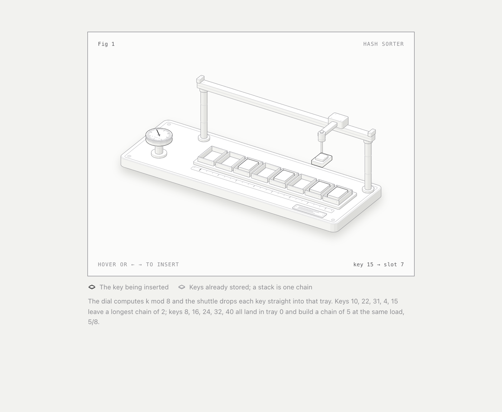
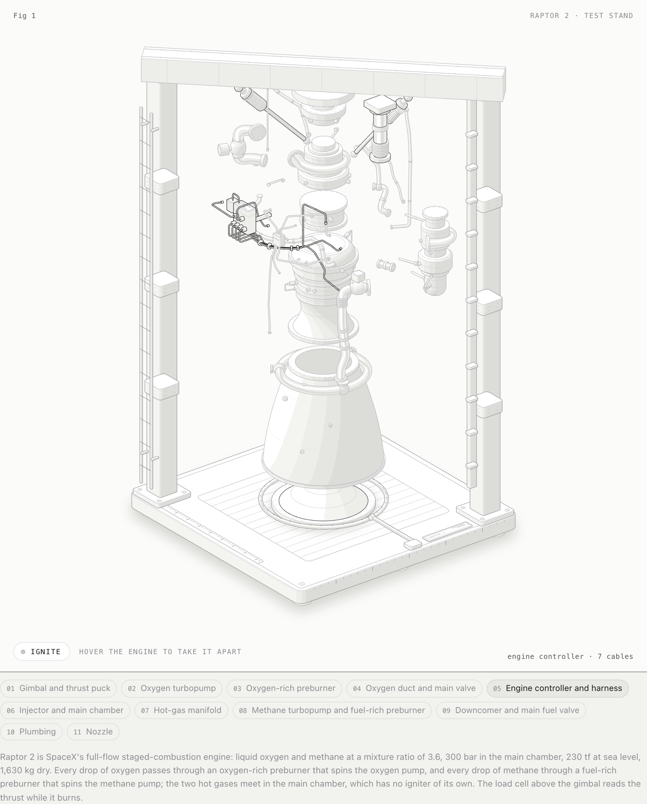
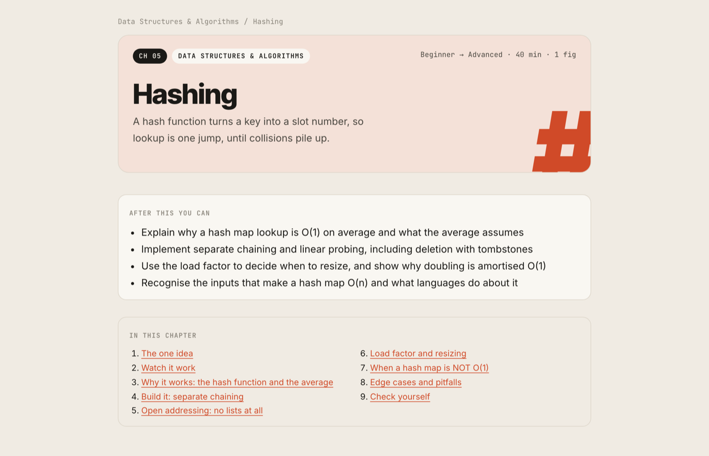
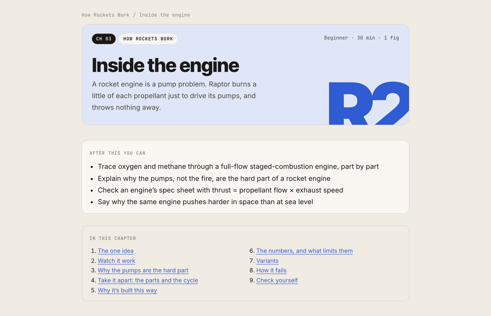

<h1 align="center">Course Studio</h1>

<p align="center">
  An agent skill that plans and writes courses on any subject (syllabi, chapters, notes and cheat sheets),<br>
  with every diagram built as an interactive isometric figure by the bundled <a href="https://github.com/wheresryan22/anatomy">Anatomy</a> engine.
</p>

<p align="center">
  <a href="https://github.com/akshaypjoshi/course-studio/actions/workflows/ci.yml"></a>
  <a href="LICENSE"></a>
  <a href="#install"></a>
  <a href="#install"></a>
  <a href="https://skills.akshayjoshi.dev/course-studio/"></a>
</p>

<p align="center">
  <picture>
    <source media="(prefers-color-scheme: dark)" srcset=".github/assets/figure-dark.png">
    
  </picture>
</p>

Ask for *"the binary search chapter"*, *"notes on consistent hashing"* or *"a course on how SpaceX rockets work"* and you get a dense, verified chapter in Markdown, a signature figure whose working **is** the chapter's insight (a shuttle that drops each key into its hash tray, a rocket engine you can take apart and fire), and a built page that has been checked in a headless browser on desktop, phone and dark mode.

**Website and live demo:** [skills.akshayjoshi.dev/course-studio](https://skills.akshayjoshi.dev/course-studio/) has both figures running live in the page, and two finished demo chapters: [Hashing](https://skills.akshayjoshi.dev/course-studio/example/dsa/05-hashing.html) from an algorithms course, and [Inside the engine](https://skills.akshayjoshi.dev/course-studio/example/how-rockets-work/03-inside-the-engine.html) from a course on how rockets work, built around SpaceX's Raptor 2 that you can take apart and fire.

## What it does

| You ask for | You get |
|---|---|
| a course, syllabus, curriculum | `course.json` (outcomes, prerequisites, chapters in dependency order, one planned figure each) + a course page and catalog |
| a chapter or lesson on X | `chapter.md` following a fixed teaching arc + its Anatomy figure + a built page |
| notes, an explainer, interview prep | `notes.md`, reusing a chapter figure where one fits |
| a cheat sheet / revision notes | `cheatsheet.md`: tables, patterns, one-liners, no new figures |
| a figure for an existing chapter | a brief, the Anatomy figure, and the rebuilt chapter |

**Any subject.** Software gets code; real machines, the body and the natural world get the real thing drawn as the figure (a rocket engine on its test stand, a four-chamber heart, a ripple tank); business and science get the mechanism behind the numbers. Real-world facts are taken from published sources, not memory. Subjects with no mechanism to show (history narratives, vocabulary) get tables and timelines instead of figures.

<p align="center">
  <picture>
    <source media="(prefers-color-scheme: dark)" srcset=".github/assets/raptor-dark.png">
    
  </picture>
  <br><sub>Fig 1 of <em>Inside the engine</em>: Raptor 2 taken apart. On the website you can hover it apart and press Ignite.</sub>
</p>

What makes the output trustworthy:

- **Every code block is run**, every number verified, and the figure is driven by the same `model.mjs` as the chapter's worked example, so text, readout and caption agree.
- **Pages are checked**, not just generated: `check_pages.py` flags JS errors, clipped or unbuilt figures, broken links, sideways scroll, empty sections and em dashes, and saves screenshots for review.
- **A consistent house style**: dense prose with no filler and no em dashes, in the text, in `course.json` and on the figure cards. `build_chapter.py` warns with line numbers and the page check catches anything that slips through.
- **An object atlas** gives starting machines for ~90 software concepts (DSA, System Design, JavaScript, Low-Level Design) and for real machines and science (rocket engines, staging, orbits, the heart, gears, locks, tides, markets), plus a method for inventing one for anything else.

<p align="center">
  <picture>
    <source media="(prefers-color-scheme: dark)" srcset=".github/assets/chapter-dark.png">
    
  </picture>
  <picture>
    <source media="(prefers-color-scheme: dark)" srcset=".github/assets/rocket-chapter-dark.png">
    
  </picture>
</p>

## Install

One install. The Anatomy figure engine is bundled inside the skill, so there is nothing else to add.

### With the skills CLI (`npx`)

```bash
npx skills add akshaypjoshi/course-studio -g -a claude-code
```

Drop `-g` to install into the current project instead of globally, or swap `-a claude-code` for another agent the [skills CLI](https://github.com/vercel-labs/skills) supports.

### As a Claude Code plugin (`/plugin`)

Inside Claude Code:

```
/plugin marketplace add akshaypjoshi/course-studio
/plugin install course-studio@course-studio
```

### Requirements

| | Needed for |
|---|---|
| Python 3.9+ with `markdown`, `pyyaml`, `pygments` | building pages |
| `playwright` + Chromium | `check_pages.py` |
| Node.js 20.10+ | building Anatomy figures |

```bash
# installed with npx -g:
pip install -r ~/.claude/skills/course-studio/requirements.txt
# installed as a plugin:
pip install -r ~/.claude/plugins/marketplaces/course-studio/skills/course-studio/requirements.txt

python3 -m playwright install chromium
```

Without Node or Chromium the skill still plans and writes; figures stay as dashed "pending" boxes showing their brief, and it tells you the command to build them later.

## Use it

Just ask, in any project:

```
Plan a System Design course, about 30 hours, for engineers preparing for senior interviews.
Write chapter 4 of the DSA course: binary search.
Notes on the JavaScript event loop, with a figure.
Plan a short course on how SpaceX rockets work, for curious adults.
A lesson on how the heart pumps blood, for high-school students.
Cheat sheet for graph algorithms.
```

Work lands in `./courses/`:

```
courses/
  _anatomy/                     vendored Anatomy kit (pinned per workspace)
  catalog.html                  every course
  dsa/
    course.json                 card, outcomes, syllabus, planned figures
    chapters/05-hashing/
      chapter.md                source of truth (GFM/MDX-friendly)
      figures/fig-01-hash-sorter/{brief.md, model.mjs, build.mjs, *.html}
    dist/                       built pages: index.html, 05-hashing.html …
  how-rockets-work/
    course.json                 a course outside software, with its own accent colour
    chapters/03-inside-the-engine/
      chapter.md
      figures/fig-01-engine-cycle/{brief.md, model.mjs, build.mjs, raptor.mjs, …}
    dist/
```

Both courses ship with the skill as worked examples (`skills/course-studio/examples/courses/`), and they are the demos on the website.

Built pages are self-contained HTML (figures embedded) apart from web fonts. Open them, publish them, or feed `chapter.md` to your own platform: callouts use GitHub's `> [!NOTE]` syntax and figures are a single `::figure <id>` line a remark plugin can map to a component.

### Course colours

Each course gets one accent colour on its pages and catalog card. Set `accent` and `tint` (and their dark variants) in `course.json`, as the rockets example does; otherwise a neutral palette is used. Four slugs come with colours and a starting syllabus already: `dsa`, `system-design`, `javascript-deeply` and `low-level-design`.

## The scripts

All in `skills/course-studio/scripts/`; the skill runs them for you.

| Script | Does |
|---|---|
| `workspace.py init <courses>` | copies the bundled Anatomy engine into `<courses>/_anatomy/` (`--anatomy <path>` or `ANATOMY_SKILL` to use another copy) |
| `workspace.py course \| chapter \| figure …` | scaffolds `course.json`, `chapter.md` + briefs, a figure folder |
| `build_chapter.py <chapter.md>` | chapter / notes / cheat-sheet page with embedded figures; warns on em dashes |
| `build_course.py <course-dir>` / `<courses> --catalog` | course page with syllabus / catalog grid |
| `check_pages.py <dist> [--mobile] [--dark]` | headless checks + screenshots; exits 1 on any problem |

## Development

```bash
pip install -r skills/course-studio/requirements.txt && python3 -m playwright install chromium
tests/smoke.sh        # rebuilds both example courses, checks every page, and confirms em dashes are caught
```

CI runs the smoke test on every push, validates the plugin manifests and `SKILL.md` frontmatter, and fails if an em dash appears anywhere in the repository (`tools/check_no_em_dash.py`).

```
.claude-plugin/            plugin.json + marketplace.json (the /plugin install path)
skills/course-studio/      the skill itself (what npx skills add installs)
  SKILL.md                 entry point: scope table, workflows, quality bar
  references/              course design, writing rules, figures, object atlas
  scripts/                 workspace, build_chapter, build_course, check_pages
  assets/                  page CSS and templates (course.json, brief.md, build.mjs)
  examples/courses/        two finished chapters with their figures: dsa (Hashing), how-rockets-work (Inside the engine)
  anatomy/                 the bundled Anatomy engine (pinned in VERSION)
evals/                     trigger evals and task evals (skill-creator format)
site/                      the website: landing page + build.py (builds the live demo)
tests/smoke.sh             end-to-end smoke test
tools/update-anatomy.sh    re-vendor Anatomy from upstream
```

The website is published from the [akshaypjoshi/skills](https://github.com/akshaypjoshi/skills) hub, which runs `site/build.py` and deploys to GitHub Pages. Preview it locally with `python3 site/build.py /tmp/site && python3 -m http.server -d /tmp/site`.

To update the bundled Anatomy engine, run `tools/update-anatomy.sh [git-ref]`, then `tests/smoke.sh`. See [CONTRIBUTING.md](CONTRIBUTING.md) for the rest, and [CHANGELOG.md](CHANGELOG.md) for what changed in each version.

## Credits

Figures are drawn with [Anatomy](https://github.com/wheresryan22/anatomy) by Ryan ([@wheresryan22](https://github.com/wheresryan22)), bundled under its MIT license (see [THIRD_PARTY_NOTICES.md](THIRD_PARTY_NOTICES.md)). The bundled copy leaves out Anatomy's community-gallery publisher and its test suite; for standalone isometric figures outside courses, install Anatomy itself.

## License

[MIT](LICENSE)
